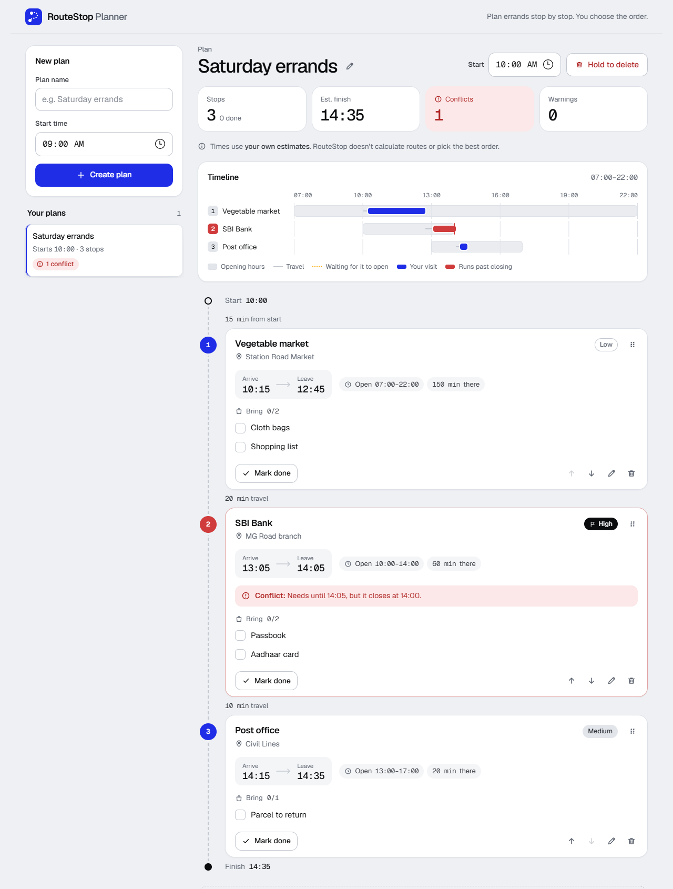
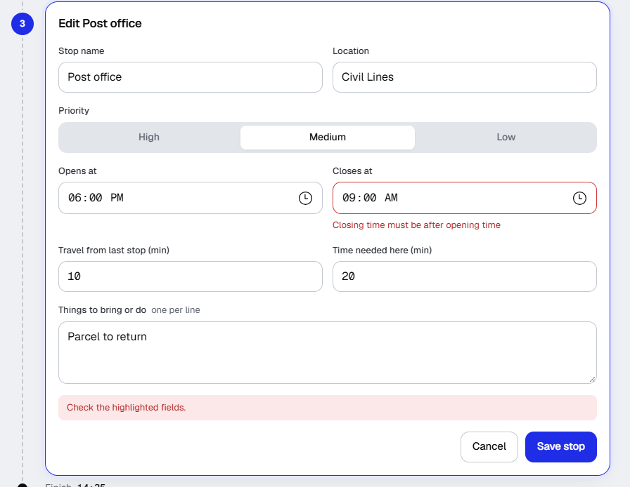
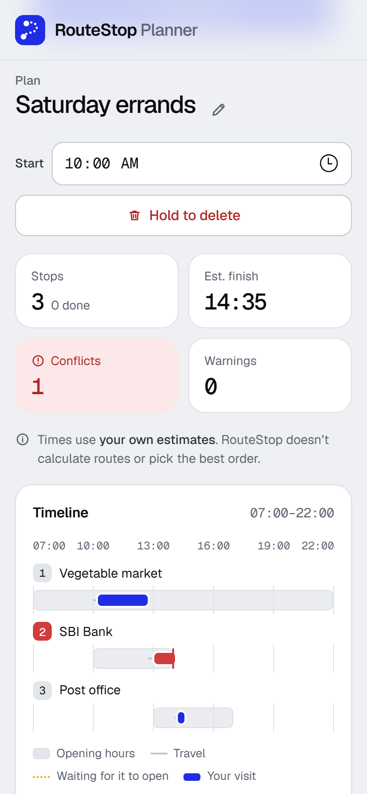
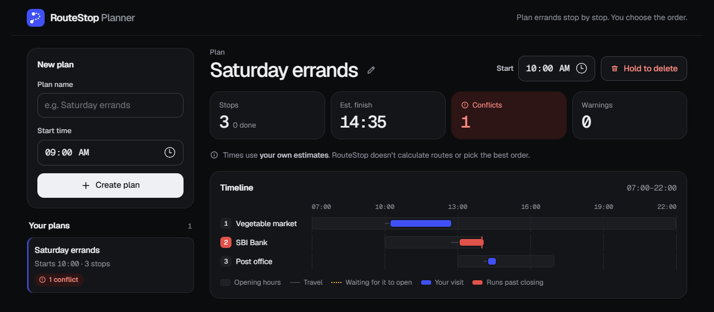

# 📍 RouteStop Planner

A multi-stop errand organiser. Make a plan, add stops with a **location**, **opening hours**, **priority** and **things to bring**, put them in your own order, and the app **flags time-window conflicts** (e.g. "you'll reach the bank after it closes").

> Travel and visit times are **your own estimates**. The app does not calculate routes or claim to find the best order.

**Stack:** React (Vite) · Node.js + Express REST API · MongoDB (Mongoose) · express-validator · Jest
**UI:** Motion (drag-to-reorder, layout animation) · Sonner (toasts with Undo) · Geist + Geist Mono fonts



## Features
- Multiple plans, each with a start time; rename a plan in place
- Stops: name, location, opens/closes, priority, travel + visit minutes, item checklist, done
- **Route view:** stops sit on a line from Start to Finish, with the travel time between each pair
- **Timeline:** every stop's opening hours, travel, waiting and visit on one time axis; a visit that runs past closing turns red. Hover or focus a row for its times
- **Reorder** by dragging the ⋮⋮ handle, with ↑ / ↓ buttons, or with the arrow keys on the handle (saved to the database)
- Flags: 🔴 arrives after closing · 🔴 not enough time before closing · 🟡 arrives before opening. Each flag has an icon and a label, so colour never carries the meaning alone
- Ticks, done and reorder update on screen at once and save in the background, in order; if a save fails the plan reloads from the server
- Delete a stop, then **Undo** from the toast; delete a plan by **holding** the button (no pop-up confirm)
- **Try a sample plan** button for a first run or a demo
- Validation on the server (express-validator) + browser form checks; field errors shown under each field
- Central error handler with one JSON error format; friendly messages in the UI
- Responsive and touch-friendly: plans become a swipeable row on phones, 44px tap targets, 16px inputs (no iOS zoom), safe-area padding
- Light and dark themes follow the device setting; motion respects *reduce motion*

## Project structure
```
server/
  server.js           connect to MongoDB, start API
  app.js              Express app, 404 + error handler
  routes/plans.js     REST endpoints
  validation.js       input validation rules
  schedule.js         arrival/departure + conflict flags
  models/Plan.js      Mongoose schema (stops embedded in plan)
  *.test.js           Jest tests
  seed-worst-case.js  dev check: a plan full of worst-case data (npm run seed:worst)
client/src/
  App.jsx             plan list, new plan, empty state
  PlanView.jsx        stats, route of stops, drag/move, checklist, undo
  Timeline.jsx        the day-at-a-glance chart
  StopForm.jsx        add/edit stop
  HoldButton.jsx      press-and-hold to delete
  Icons.jsx           stroke icons + logo
  sample.js           the sample plan
  api.js              fetch calls
  styles.css          design tokens, layout, light/dark, motion
docs/                 report, viva notes, screenshots
```

## Run it (Windows)
1. Install **Node.js 22 LTS** or newer (https://nodejs.org).
2. Set up MongoDB: either install **MongoDB Community Server** locally, or create a free **MongoDB Atlas** M0 cluster and copy its connection string.
3. Configure and start the API:
   ```bat
   cd server
   copy .env.example .env
   npm install
   npm run dev
   ```
   If you use Atlas, put your connection string in `MONGO_URI` in `server\.env`.
4. In a second terminal, start the UI:
   ```bat
   cd client
   npm install
   npm run dev
   ```
5. Open http://localhost:5173 and click **Try a sample plan**.

Tests: `cd server && npm test`

Stress check (API running): `cd server && npm run seed:worst` adds a plan with the longest allowed names, a pasted map link, Hindi and Kannada text, emoji and a day that runs past midnight, plus a one-stop plan. Delete them in the app when done.

## API (`/api/plans`)
| Method | Path | Body |
|---|---|---|
| GET | `/` | |
| POST | `/` | `{ title, startTime }` |
| GET / PUT / DELETE | `/:id` | PUT: `{ title, startTime }` |
| POST | `/:id/stops` | stop |
| PUT / DELETE | `/:id/stops/:stopId` | PUT: stop |
| PATCH | `/:id/stops/reorder` | `{ order: [stopId, ...] }` (every stop once) |

Stop: `{ name, location, opensAt: "10:00", closesAt: "14:00", priority: "high|medium|low", travelMins, visitMins, items: [{ text, done }], completed }`

Errors: `{ "error": { "message": "...", "details": [{ "field", "message" }] } }`, with status 400 (bad input), 404 (not found), 503 (database down) or 500.

## Screenshots
| Reordered, conflict gone | Validation | Mobile |
|---|---|---|
|  |  |  |

Dark theme:



## Limits
Opening hours can't cross midnight and allow only one window per day. There are no user accounts.

**Author:** Shashank Singh · [Course / Semester] · S-VYASA · CIA 2, [Subject]
