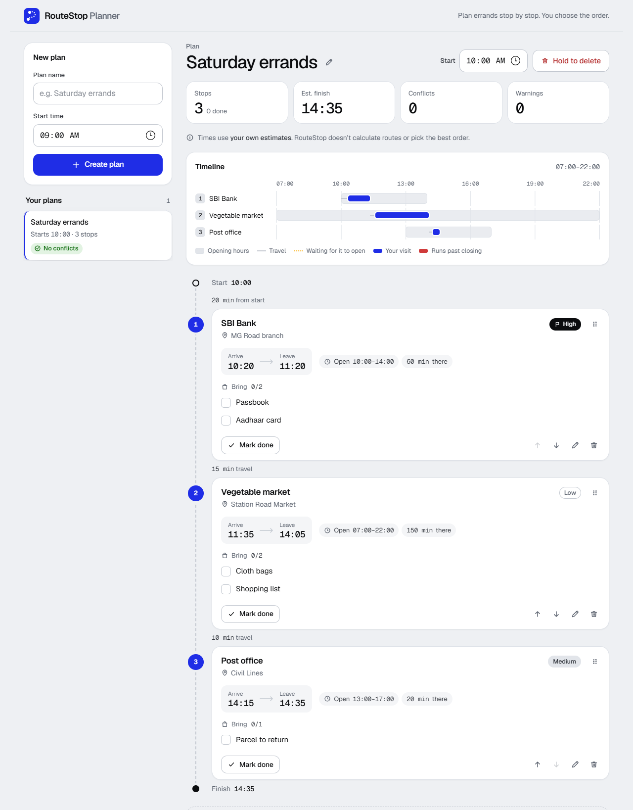

# 📍 RouteStop Planner

A multi-stop errand organiser. Make a plan, add stops with a **location**, **opening hours**, **priority** and **things to bring**, put them in your own order, and the app **flags time-window conflicts** (e.g. "you'll reach the bank after it closes").

> Travel and visit times are **your own estimates**. The app does not calculate routes or claim to find the best order.

**Stack:** React (Vite) · Node.js + Express REST API · MongoDB (Mongoose) · express-validator · Jest


## Features
- Multiple plans, each with a start time
- Stops: name, location, opens/closes, priority, travel + visit minutes, item checklist, done
- Reorder with ↑ / ↓ (saved to the database)
- Flags: 🔴 arrives after closing · 🔴 not enough time before closing · 🟡 arrives before opening
- Validation on the server (express-validator) + browser form checks; field errors shown in the form
- Central error handler with one JSON error format; friendly messages in the UI
- Responsive: one column on phones, two columns on laptops

## Project structure
```
server/
  server.js         connect to MongoDB, start API
  app.js            Express app, 404 + error handler
  routes/plans.js   REST endpoints
  validation.js     input validation rules
  schedule.js       arrival/departure + conflict flags
  models/Plan.js    Mongoose schema (stops embedded in plan)
  *.test.js         Jest tests
client/src/
  App.jsx           plan list + new plan
  PlanView.jsx      stops, reorder, checklist
  StopForm.jsx      add/edit stop
  api.js            fetch calls
  styles.css        responsive styles
docs/               report, viva notes, screenshots
```

## Run it (Windows)
1. Install **Node.js 22 LTS** (https://nodejs.org).
2. Set up MongoDB: either install **MongoDB Community Server** locally, or create a free **MongoDB Atlas** M0 cluster and copy its connection string.
3. Configure and start the API:
   ```bat
   cd server
   copy .env.example .env
   npm install
   npm run dev
   ```
   If you use Atlas, put your connection string in `MONGO_URI` in `server\.env`.
4. In a second terminal, start the UI:
   ```bat
   cd client
   npm install
   npm run dev
   ```
5. Open http://localhost:5173

Tests: `cd server && npm test`

## API (`/api/plans`)
| Method | Path | Body |
|---|---|---|
| GET | `/` | |
| POST | `/` | `{ title, startTime }` |
| GET / PUT / DELETE | `/:id` | PUT: `{ title, startTime }` |
| POST | `/:id/stops` | stop |
| PUT / DELETE | `/:id/stops/:stopId` | PUT: stop |
| PATCH | `/:id/stops/reorder` | `{ order: [stopId, ...] }` (every stop once) |

Stop: `{ name, location, opensAt: "10:00", closesAt: "14:00", priority: "high|medium|low", travelMins, visitMins, items: [{ text, done }], completed }`

Errors: `{ "error": { "message": "...", "details": [{ "field", "message" }] } }`, with status 400 (bad input), 404 (not found), 503 (database down) or 500.

## Screenshots
| Reordered, conflict gone | Validation | Mobile |
|---|---|---|
|  |  |  |

## Limits
Opening hours can't cross midnight and allow only one window per day. There are no user accounts.

**Author:** Shashank Singh · [Course / Semester] · S-VYASA · CIA 2, [Subject]
